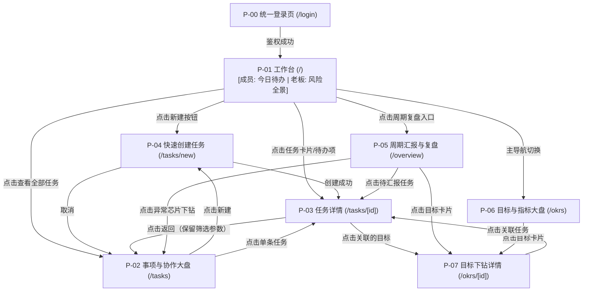

# okr-dashboard 页面重做产品与设计需求说明书 (Redesign Brief)

**产品与设计定义**：测试与体验分析师 (antigravity)  
**目标受众**：UI/UX 设计师、前端交互设计师、产品经理  
**设计目标**：无需阅读任何后端代码，仅看本文档即可输出完整的高保真交互线框稿与设计系统组件库。

---

## 1. 业务全景与重做指导思想

### 1.1 真实业务现状与核心矛盾
* **团队现状**：4 个账号（1 个老板、3 个成员）。属于小规模、高频协同的业务团队。
* **数据现状**：线上仅有 1 个目标、0 个关键结果（KR）；但有 18 个任务（15 个处于活跃状态，其中 13 个没有固定截止日期）。
* **核心矛盾**：
  * **原系统**：重度围绕 OKR、Period（周/月/季汇报树）、RACI 矩阵模型设计。大量展示生硬的概念和强制性的打卡机制。
  * **实际业务**：团队把系统当成**「任务分工、协作推进与进度同步看板」**。成员最关心“我今天该干什么、王芳交付了没有、卡在哪里”；老板最关心“重要事项有没有人盯、有没有风险、什么时候有结果”。

### 1.2 重做核心原则
1. **以任务与协作为绝对主角**：将「任务看板/事项流转」提到首要视觉层级，弱化生硬的 OKR 层级与 WBS 技术概念。
2. **包容无明确期限事项（修复 UX-01）**：允许灵活跟进，无期限任务必须在工作台和周看板中一视同仁呈现，提供「本周待推进」与「待排期」清晰分组。
3. **轻量化闭环跟进（修复 UX-02/UX-07）**：将周汇报与日常进展合并为轻量动态流；主责移交时一键转移所有权责，彻底消除越权与冗余操作。
4. **全端原生体验（修复 UX-08/移动端痛点）**：移动端采用标准底部 Tab 导航 + 顶部轻量状态条，告别侧边栏挤压；所有卡片与操作按钮满足 44px+ 触控标准。
5. **通俗易懂的运营语言（修复 UX-09）**：全面剔除“无行”、“WBS”、“RACI”等技术术语，换用“主责人”、“协作分工”、“交付物”、“打卡”等直观语汇。

---

## 2. 建议的新页面结构与导航流转

### 2.1 页面清单 (Site Map)

| 页面 ID | 页面名称 | 访问路径 | 主要用户 | 页面核心用途 |
| :--- | :--- | :--- | :--- | :--- |
| **P-00** | 统一登录页 | `/login` | 全员 | 简洁品牌传达、短账号/邮箱一键登录 |
| **P-01** | 工作台（首页） | `/` | 成员 / 老板 | **最高频页面**。成员看「今日待办/待跟进/我的协作」，老板看「部门全景与风险待办」 |
| **P-02** | 事项与协作大盘 | `/tasks` | 全员 | 所有任务的集中清单，支持按状态、领域、人员、异常（逾期/风险/待确认）灵活筛选 |
| **P-03** | 任务详情与协作工作台 | `/tasks/[id]` | 全员 | 事项信息维护、分工安排、子交付记录、进展更新与历史动态流 |
| **P-04** | 新建/快速录入事项 | `/tasks/new` | 成员 | 极简录入卡片（支持 30 秒快捷创建，非必填项默认折叠） |
| **P-05** | 周期汇报与复盘 (原 overview) | `/overview` | 老板 / 成员 | 按周/月/季进行阶段总结、未打卡催办、老板下钻（弱化，作为辅助复盘工具） |
| **P-06** | 目标与指标大盘 (原 okrs) | `/okrs` | 老板 / 成员 | 业务核心大目标卡片，挂载关键结果指标及关联的任务列表（轻量化展示） |
| **P-07** | 目标下钻详情 | `/okrs/[id]` | 全员 | 查看特定大目标下的所有 KR 进展、支撑任务流与历史变动 |

---

### 2.2 页面跳转与路由关系图 (Mermaid)

---

## 3. 各页面详细需求规格

### 3.1 P-01 工作台（首页 `/`）
* **定位**：每日高频打开的第一站，角色自适应。
* **主要用户**：
  * **成员**：关注“我今天要做什么、谁卡了我、我需要向谁交差”。
  * **老板**：关注“整个部门在跑什么、哪里亮红灯、谁卡住了”。
* **最高频的 3 个操作**：
  1. 点击任务卡片更新最新进展（或一键标记“今日无变化”）；
  2. 点击「＋ 记个事项」快速录入；
  3. 老板点击「风险/阻塞/待确认」快速查看详情并催办。
* **引用解决的 UX 问题**：UX-01（无期限任务展示在待办池中）、UX-06（消除生硬的周/月汇报隔离）、UX-08（移动端首屏直达）。
* **页面展示字段**：
  * 顶部看板欢迎条：当前登录人、今天日期、本周工作日进度；
  * 核心指标区（3~4 个微卡片）：进行中事项数、今日需跟进数、有风险/受阻数、本周已完成数；
  * 任务分栏：
    * 成员视图：【待我跟进/今日跟进】、【我的协作（待我交付）】、【我发起的长期事项】；
    * 老板视图：【风险与受阻事项（重点红色）】、【今日需确认事项】、【部门各成员在办负荷】。
* **异常状态处理**：
  * **空数据**：展示插画 + 绿色标签“太棒了！今天没有需要紧急跟进的事项”，并附带「＋ 记个新事项」按钮。
  * **加载中**：卡片骨架屏（Skeleton）闪烁效果，避免白屏。
  * **出错**：保留顶部导航，局部出现“获取今日待办失败，[重试]”。

---

### 3.2 P-02 事项与协作大盘（`/tasks`）
* **定位**：全量任务知识库与多维筛选表格/看板。
* **最高频操作**：
  1. 按责任人、状态（进行中/已完成）、责任领域筛选；
  2. 搜索关键词（任务名/交付内容/SKU）；
  3. 点击表头或视图切换（看板视图 / 列表视图）。
* **展示字段**：
  * 任务标题、责任领域徽章（业务/团队/库存/其他）、主负责人头像及姓名、协作成员头像列表；
  * 进展摘要（最新一条动态）、下一步动作；
  * 健康状态（按计划 绿色 / 有风险 黄色 / 受阻 红色）；
  * 截止期限（若未设置，显示灰色“未定”标签，支持直接在列表行内快捷补填日期）；
  * 下次跟进日期（今天到期高亮橙色，逾期标红）。
* **状态展示**：
  * 筛选无结果：显示“没有匹配的事项，[清除所有筛选条件]”。

---

### 3.3 P-03 任务详情与协作工作台（`/tasks/[id]`）
* **定位**：单项业务执行、协作与沉淀的核心战场。
* **主要用户**：主负责人（李明）、协作者（王芳）、老板（只读视察）。
* **最高频操作**：
  1. 主负责人点击「更新进展 / 暂无变化」（弹窗或内联流畅录入，不需要跳页）；
  2. 协作者在「我的协作」区域提交自己的交付成果；
  3. 移交主负责人（移交后自动转移权责并清空旧授权，彻底修复 UX-02）；
  4. 标记完成与归档。
* **展示字段**：
  * **顶部信息区**：面包屑导航（带完整前置筛选记忆）、任务标题（可点编辑）、健康状态徽章、优先级徽章、老板只读水印；
  * **核心要素卡片**：
    * 完成标准（交付什么、做到什么程度）；
    * 最新进展与下一步动作（包含最后更新时间、更新人）；
    * 风险/求助说明（仅当有风险时醒目展示）；
    * 期限与跟进：截止时间（可快捷修改）、下次跟进日期；
    * 关联目标（可点击跳转至目标详情）。
  * **协作分工区**：
    * 协作者卡片：协作者姓名、分派交付内容、交付期限、协作者提交的交付成果、完成状态（待交付 / 已交付）；
    * 主责操作：【＋ 安排协作成员】；
    * 协作者操作：【提交我的交付】（仅当前登录人是该协作者且任务未结束时可见）。
  * **进展与历史流水（Timeline 动态流）**：
    * 倒序展示：每一次进展提交、暂无变化确认、分工变更、移交记录、完成/恢复动作，清晰标注时间与操作人。
* **交互规则（重点修复 UX-02）**：
  * 主责移交确认：点击“移交主负责人”，弹出二次确认弹窗：“确定将任务移交给【王芳】吗？移交后你将不再拥有主责推进与周期打卡权限。”
  * 移交保存后，后端同步清理原负责人的权限，页面前端即刻响应，旧负责人页面刷新为“非主责视图”。

---

### 3.4 P-04 新建/快速录入事项（`/tasks/new`）
* **定位**：轻量、无门槛的事项录入抽屉或独立页。
* **最高频操作**：
  1. 快速输入任务名称与完成标准；
  2. 指定主负责人（默认当前登录人）；
  3. 一键创建（30 秒内完成）。
* **引用解决的 UX 问题**：UX-07（解除死板的下一步与跟进强校验）。
* **字段规划与渐进式展示（Progressive Disclosure）**：
  * **核心必填区（默认展开）**：
    * 任务名称（Input，必填，支持快速输入）；
    * 完成标准（Textarea，必填，明确做到什么算完成）；
    * 主负责人（Select，默认当前登录人，可切换）；
  * **进阶选填区（默认轻量展示或手风琴折叠）**：
    * 责任领域（业务 / 团队 / 库存 / 其他，默认业务）；
    * 截止期限（DatePicker，选填，支持留空，提示“尚未确定可先留空，随时补充”）；
    * 关联大目标（Select，选填，不强制挂靠）；
    * 优先级（常规 / 重点 / 低优先，默认常规）；
    * 下一步动作（选填，若用户未填写，系统自动填入“明确推进计划”）。

---

### 3.5 P-05 周期汇报与复盘（`/overview`）
* **定位**：周会/月会投影与复盘工具（从高频操作退居为周期性工具）。
* **主要功能**：
  * 周打卡（Check-in）漏斗：显示谁还没交本周同步，支持一键“暂无变化”快速打卡；
  * 修复 UX-01：所有活跃的未完成任务（无论是否定截止日）均默认纳入当前周看板的汇报候选池。

---

### 3.6 P-06 目标与关键结果大盘（`/okrs`）与 P-07 详情
* **定位**：季度战略大盘。
* **结合线上数据的设计优化**：
  * 线上仅 1 目标 0 KR，说明复杂的指标拆解脱离实际。
  * 新设计采用「大目标卡片 + 关键指标 + 支撑事项」扁平化结构，不再强求每个成员去维护复杂的数学加权；
  * 目标详情页重点列出：“为了达成这个目标，目前团队在推进哪 5 个具体任务，哪个任务受阻了”。

---

## 4. 全局设计系统组件清单与所有状态定义

设计稿需提供以下基础组件及其完备状态：

### 4.1 按钮组件 (Button)
* **类型**：
  * `Primary`（主操作：创建、保存、提交）
  * `Secondary`（次要操作：安排协作、暂无变化、返回）
  * `Danger`（危险操作：归档、删除、移除分工）
  * `Ghost / Text`（纯文本链接按钮）
* **交互状态**：
  1. `Default`（常规可交互）
  2. `Hover`（鼠标悬停，底色加深 10%）
  3. `Active / Pressed`（按下微下沉）
  4. `Loading`（加载中，出现旋转 Spinner，文字变为“保存中…”，禁止重复点击）
  5. `Disabled`（禁用状态，置灰 40% 不透明度，光标 not-allowed）

---

### 4.2 状态与健康徽章 (Badge / Tag)
用于任务状态与健康度一眼识别：
* **任务状态徽章**：
  * `未开始`（灰色描边，浅灰底）
  * `进行中`（蓝色高亮，浅蓝底）
  * `等待中`（紫色，浅紫底）
  * `受阻`（深红色，浅红底，带警示图标 ⚠️）
  * `已完成`（绿色，浅绿底，带对勾图标 ✓）
  * `已取消 / 已归档`（低对比度灰底）
* **健康与风险徽章**：
  * `按计划 (On Track)`：柔和绿色
  * `有风险 (At Risk)`：警示琥珀橙色
  * `已逾期 (Overdue)`：醒目红色
  * `今天需跟进`：动态橙色呼吸点

---

### 4.3 任务卡片组件 (Task Card)
* **应用场景**：工作台看板、列表视图、周总览列表。
* **状态定义**：
  1. `Normal`（默认态：白底、细腻阴影、清晰信息分组）
  2. `Hover`（悬浮态：阴影提升，卡片微升 2px，出现快捷操作浮层）
  3. `Selected`（选中态：边框亮起品牌主色）
  4. `Risk Alert`（风险态：左侧边缘 4px 亮红条，风险说明醒目展示）
  5. `Completed`（已完成态：文字带轻度删除线，整体透明度降至 70%）
  6. `Readonly`（老板只读态：隐藏编辑把手，右上角淡色显示“查看详情”）

---

### 4.4 筛选与控制栏组件 (Filter Bar)
* **包含元素**：搜索框、责任人下拉、状态标签组、异常快捷筛子（风险、逾期、未汇报）。
* **状态定义**：
  * 激活筛选：激活项呈实体色块，后附 `(数量)`，右侧自动浮现“清除筛选 (X)”；
  * 空条件：显示通用“全部 (All)”。

---

### 4.5 移动端底部导航栏 (Mobile TabBar)
* **规格**：高度 56px + 底部安全区（iPhone Home Bar适配）；
* **Tab 项**：
  1. 🏠 工作台 (`/`)
  2. 📋 事项库 (`/tasks`)
  3. 📊 复盘 (`/overview`)
  4. 🎯 目标 (`/okrs`)
  5. 👤 我的 (账号与设置)
* **状态**：未激活（灰阶图标+文字）、激活态（品牌主色+加粗图标）。

---

## 5. 功能强化与弱化决策矩阵（结合线上实际）

| 功能模块 | 原版现状 | 重做后的决策 | 调整原因与设计方案 |
| :--- | :--- | :---: | :--- |
| **任务日常分工与进展** | 埋藏在复杂的 OKR 之下 | **★★★★★ 绝对强化突出** | 线上 18 个任务全靠此流转。工作台首屏直接放今日任务卡片，支持一键更新进展。 |
| **未设截止日的事项池** | 在周总览中完全丢失 (UX-01) | **★★★★★ 绝对强化突出** | 线上 72% 任务无期限。新版在看板中设立「灵活推进 / 待排期」常驻泳道，允许正常打卡。 |
| **协作交付物更新** | 入口深、操作割裂 | **★★★★☆ 显著强化** | 协作者打开工作台一眼看到「待我交付」，点击直接在行内输入交付结论并标记完成。 |
| **主责移交与历史追溯** | 权限未清理导致越权 (UX-02) | **★★★★☆ 强化并严格闭环** | 移交变为一键交接卡片，移交后系统自动更新所有权责并写入日志流，绝不留越权空子。 |
| **Check-in 周期打卡** | 强制周/月/季三级树打卡 | **★★☆☆☆ 大幅轻量化收起** | 4 人团队无需繁重打卡。将其简化为周五下午的“一键同步”，平时直接以任务日常动态代替。 |
| **WBS 工作分解结构** | 专业项目管理名词，令人困惑 | **★☆☆☆☆ 彻底隐藏/剔除** | 前端完全去除 WBS 字样，全部用通俗的“子交付项 / 协作内容”替代。 |
| **RACI 字母矩阵** | 显示生硬的 R/A/C 缩写 | **★☆☆☆☆ 彻底隐藏/剔除** | 前端只体现“主负责人”、“协作者”、“交由确认人”，后台自动映射底层数据，前端不露英文术语。 |
| **多层 KR 达成率数学公式** | 公式复杂，线上 KR 数据为 0 | **★☆☆☆☆ 弱化收进二级详情** | 不在首页堆砌复杂的达成率公式，仅在目标详情中按需展示。 |

---

## 6. 验收与交付检查清单（设计自测标准）

设计师输出设计稿时，需依照以下标准逐项验收：
- [ ] 页面是否在 390px 视口下完全消除了横向滚动条，内容是否留有足够边距（≥16px）；
- [ ] 移动端点击热区是否均达到或超过 44 × 44px；
- [ ] 是否在任务卡片和列表清晰展示了无期限任务，且在周视图中具备合理解释与归类（修复 UX-01）；
- [ ] 任务移交流程是否有明确的权责让渡提示，旧负责人视图是否正确转为只读（修复 UX-02）；
- [ ] 是否所有专业术语（WBS、RACI、无行、待确认）均已替换为运营通俗文案（修复 UX-09）；
- [ ] 老板账号与成员账号的只读/可编辑视觉区分是否直观；
- [ ] 空数据（Empty）、加载中（Loading）、操作出错（Error）状态是否全部有对应 UI 样式设计。
