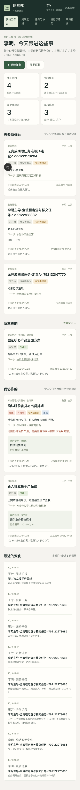

# okr-dashboard 体验走查与缺陷体检报告

**测试与体验分析师**：antigravity  
**走查时间**：2026-10-16  
**被测环境**：本地 Next.js 16 + Prisma + SQLite (`e2e.db`)  
**被测账号**：老板 `okr`（陈总·只读）、填报成员 `okr1`（李明）、`okr2`（王芳）、`okr3`（赵强），默认密码 `okr12345`  
**走查视口**：桌面端（1280 × 800）、移动端（390 × 844，iPhone 14/15 规格）  
**截图资源目录**：[`docs/health/screenshots/`](./screenshots/)

---

## 目录
1. [执行概述与真实业务背景](#1-执行概述与真实业务背景)
2. [重点疑似缺陷核实结论](#2-重点疑似缺陷核实结论)
3. [走查发现的问题清单（UX-01 ~ UX-10）](#3-走查发现的问题清单)
4. [移动端（390px 视口）专项走查问题](#4-移动端390px-视口专项走查问题)
5. [看不懂与有歧义文案专项分析](#5-看不懂与有歧义文案专项分析)
6. [走查全流程覆盖记录](#6-走查全流程覆盖记录)

---

## 1. 执行概述与真实业务背景

本次走查覆盖了老板及填报成员在看板系统中的完整核心流转：**新建任务 → 安排协作 → 协作者更新交付 → 主负责人更新进展/暂无变化 → 移交主负责人 → 标记完成 → 归档 → 恢复；周期总览 /overview 的周/月/季视图切换、异常下钻、Check-in 提交；目标看板 /okrs 的增删改查；填写指南 /guide 的说明体验；以及 390px 移动端视口适配**。

结合线上真实使用数据：
* **账号**：4 个（1 个老板，3 个成员）；
* **任务**：18 个（15 个未结束，其中 13 个未填完成期限）；
* **目标与 KR**：1 个目标，0 个关键结果；
* **现状洞察**：团队的核心日常是**快速记录任务、同步协作分工与跟进进展**。复杂的 OKR 结构（Objective - KR - Deliverables - WorkPackage）与硬性的周期 Check-in 汇报使用频次极低。系统现存多处逻辑断层与术语壁垒，导致高频的任务流转受阻，特别是无期限任务直接在周期总览中隐形，造成严重的业务脱节。

---

## 2. 重点疑似缺陷核实结论

### 疑似缺陷 (a)：新建未填完成期限的任务，是否出现在 /overview 本周的「待我汇报」和任务列表中
* **核实结论**：**确认存在（严重缺陷，编号 UX-01）**。
* **实际表现**：
  * 成员 okr1 新建一个不填完成期限的任务（`dueAt = null`）并成功保存；
  * 访问 `/overview?kind=WEEK`（本周周期总览），无论是在「本周期任务」清单、还是在「待我汇报」区域，**均完全找不到该任务**；
  * 该任务直接被系统周视图吞没。
* **深层根因**：
  * 在底层实现中，任务创建时（`createTask`）未设置 `schedulePeriodId`（存储为 `null`）；
  * 当用户没有设置 `dueAt`（完成期限）时，`dueAt` 亦为 `null`；
  * `/overview` 页面查询本周任务依赖 `tasksInPeriod` 函数：
    ```typescript
    const or: Prisma.TaskWhereInput[] = [
      { schedulePeriodId: { in: periodIds } },
      { dueAt: { gte: period.startAt, lt: period.endAt } },
    ];
    ```
  * 由于该任务 `schedulePeriodId` 为空且 `dueAt` 为空，在 WEEK 维度查询条件 `OR` 中完全无法命中，直接被过滤掉；
  * 进而，计算未汇报项（`expectedTargets`）和异常芯片统计时亦将其忽略。
* **业务危害**：线上 18 个任务中有 13 个（72%）没有填完成期限！这意味着线上绝大多数正在推进的事项在周汇报总览中全部不可见，成员无法在周看板看到自己本周需汇报的事项，老板周会也看不到这些事项的进度缺口。

---

### 疑似缺陷 (b)：把任务移交给他人后，原负责人是否仍能为这个任务提交周期汇报
* **核实结论**：**确认存在（越权与数据权限漏洞，编号 UX-02）**。
* **实际表现**：
  * 任务「验证核心产品主图方案」原主负责人为李明（`okr1`），系统初始为其分配了 RACI（李明具有 R 负责人与 A 问责人身份）；
  * 李明在任务详情的「任务资料与分工」中将主负责人移交给王芳（`okr2`）并保存；
  * 保存后页面提示负责人已变为王芳；
  * 李明（原主负责人）重新进入该任务详情页面，**页面上依然高亮展示「周更新 Check-in 提交表单」**；
  * 李明在表单中输入进展并点击提交，服务端返回 `200` 成功，Check-in 记录成功写入数据库，归属于李明。
* **深层根因**：
  * 在移交负责人的逻辑（`mutateTask(..., "details")`）中，系统仅更新了 `Task.ownerId = newOwnerId`，将 `lastConfirmedAt` 置为空；
  * **系统完全没有联动更新或清理 `RaciAssignment` 表中对应任务的 RACI 记录**，李明在 `RaciAssignment` 中的 `role = 'R'` 与 `role = 'A'` 记录依然永久留存；
  * 汇报权限判断函数 `canAuthorCheckIn` 逻辑为：
    ```typescript
    if (scopeType === CheckInScopeType.TASK) {
      return task.ownerId === actor.id || hasRaciRA(db, actor.id, RaciSubjectType.TASK, scopeId);
    }
    ```
  * 因为李明在数据库中依然拥有该任务的历史 R/A 授权，`hasRaciRA` 判定依然为 `true`；
  * 导致原主责移交后，仍然拥有向该任务提交正式周期汇报的权限，权责未能转移。
* **业务危害**：任务已经移交他人，原负责人依然能替他人提交甚至覆盖本周汇报内容，造成管理汇报混乱与责任主体错位。

---

## 3. 走查发现的问题清单

| 编号 | 问题标题 | 涉及页面 | 严重程度 | 截图定位 |
| :--- | :--- | :--- | :---: | :--- |
| **UX-01** | 未填完成期限的任务在周总览与待我汇报中完全隐形 | `/overview` | **P0** | `screenshots/11-defect-a-task-detail.png`<br>`screenshots/12-defect-a-overview-week.png` |
| **UX-02** | 任务主责移交后原负责人仍具 Check-in 提交权限（RACI 未清理） | `/tasks/[id]` | **P0** | `screenshots/18-task-handed-over-to-okr2.png`<br>`screenshots/defect-b-verified.png` |
| **UX-03** | 前台新建任务漏调 RACI 默认分工初始化，导致展示缺失 | `/tasks/new` | **P1** | `screenshots/11-defect-a-task-detail.png` |
| **UX-04** | 老板只读模式下缺乏向目标与任务的直观聚合导航闭环 | `/okrs` | **P1** | `screenshots/07-boss-okrs-readonly.png` |
| **UX-05** | 详情页返回链接在特定刷新或深层路径下丢失周期上下文 | `/tasks/[id]` | **P1** | `screenshots/06-boss-task-detail-readonly.png` |
| **UX-06** | 周/月/季视图切换时，待汇报对象在任务/KR/目标之间剧烈跳变无指引 | `/overview` | **P1** | `screenshots/02-boss-overview-week.png`<br>`screenshots/03-boss-overview-month.png` |
| **UX-07** | 新建任务表单强行校验「下一步」与「下次跟进」，阻碍轻量录入 | `/tasks/new` | **P2** | `screenshots/10-okr1-task-new-form.png` |
| **UX-08** | 协作者交付物与关键节点折叠层级过深，状态反馈微弱 | `/tasks/[id]` | **P2** | `screenshots/13-okr1-collaborator-assigned.png` |
| **UX-09** | 目标看板缺少弹窗/抽屉，行内表单直接铺开视觉杂乱 | `/okrs` | **P2** | `screenshots/23-okrs-board.png`<br>`screenshots/24-okrs-created.png` |
| **UX-10** | 周期总览顶部异常芯片下钻与统计卡片命名层级割裂 | `/overview` | **P2** | `screenshots/02-boss-overview-week.png` |

---

### 问题详细说明

#### UX-01：未填完成期限的任务在周总览与待我汇报中完全隐形
* **严重程度**：P0 功能错误
* **复现步骤**：
  1. 成员 okr1 登录，点击「＋ 新建任务」；
  2. 填写任务名称「测试无期限事项」、完成标准、下一步动作，**完成期限输入框留空**，提交创建；
  3. 任务创建成功进入详情页（显示完成期限：未设置）；
  4. 点击顶部/导航栏「周期汇报」（`/overview?kind=WEEK`）。
* **实际结果**：
  * 在周期结果中，「本周期任务」数量未包含该任务；
  * 在「待我汇报」区域，完全没有该任务的汇报入口；
  * 在下方「本周期任务」列表中，该任务完全不存在。
* **预期结果**：未填完成期限但处于活跃/进行中的任务，应默认计入当前业务周期，或设立「待排期/未定截止日」分组，允许成员在周会前提交进展。
* **截图参考**：
  * 任务详情：[`screenshots/11-defect-a-task-detail.png`](./screenshots/11-defect-a-task-detail.png)
  * 周总览漏出：[`screenshots/12-defect-a-overview-week.png`](./screenshots/12-defect-a-overview-week.png)

---

#### UX-02：任务主责移交后原负责人仍具 Check-in 提交权限
* **严重程度**：P0 功能错误
* **复现步骤**：
  1. 成员 okr1 登录，进入已有 RACI 记录的任务（如「验证核心产品主图方案」）；
  2. 展开「任务资料与分工」，将主负责人从「李明」修改为「王芳」，点击保存；
  3. 页面刷新后，主负责人已变更为王芳；
  4. 当前登录人（李明）停留在该任务详情页，页面中仍渲染了「周更新」Check-in 提交表单；
  5. 李明在表单中输入进展并提交。
* **实际结果**：李明成功提交了周汇报，汇报历史中显示为李明提交，新负责人王芳的权责被越过。
* **预期结果**：任务移交后，原负责人的 R/A 权限应被自动移交或重置，原负责人页面应变为“无权提交汇报（只读展示）”。
* **截图参考**：
  * 移交后展示：[`screenshots/18-task-handed-over-to-okr2.png`](./screenshots/18-task-handed-over-to-okr2.png)
  * 越权提交成功：[`screenshots/defect-b-verified.png`](./screenshots/defect-b-verified.png)

---

#### UX-03：前台新建任务漏调 RACI 默认分工初始化
* **严重程度**：P1 明显影响使用
* **复现步骤**：在前台点击「＋ 新建任务」创建任意任务，创建后在任务详情页查看周更新区域的 RACI 提示。
* **实际结果**：页面显示“RACI：尚未回填”；数据库 `RaciAssignment` 表中无该任务任何数据。
* **预期结果**：新任务创建时，应自动为创建的主负责人绑定 RACI 中的 R（负责人）和 A（问责人）。
* **截图参考**：[`screenshots/11-defect-a-task-detail.png`](./screenshots/11-defect-a-task-detail.png)

---

#### UX-04：老板只读模式下缺乏向目标与任务的直观聚合导航闭环
* **严重程度**：P1 明显影响使用
* **实际结果**：老板账号在 `/okrs` 下虽然成功隐藏了增删改表单，但目标卡片仅显示简陋的百分比和指标数值，缺乏“当前目标关联了哪些任务、谁在负责、当前有没有风险”的直观聚合视图，下钻链接较为隐蔽。
* **截图参考**：[`screenshots/07-boss-okrs-readonly.png`](./screenshots/07-boss-okrs-readonly.png)

---

#### UX-05：详情页返回链接在特定刷新或深层路径下丢失周期上下文
* **严重程度**：P1 明显影响使用
* **实际结果**：若用户从带筛选的列表进入详情后手动刷新，或者从其他模块跳转，顶部的返回导航可能退化为普通 `/tasks`，用户在周看板筛选出的上下文（如 `kind=WEEK&exception=unreported`）容易丢失。
* **截图参考**：[`screenshots/06-boss-task-detail-readonly.png`](./screenshots/06-boss-task-detail-readonly.png)

---

#### UX-06：周/月/季视图切换时，待汇报对象在任务/KR/目标之间剧烈跳变无指引
* **严重程度**：P1 明显影响使用
* **实际结果**：用户在 `/overview` 顶部点击「本月复盘」标签时，「待我汇报」列表原本的任务列表瞬间变成了关键结果（KR）；切换到「本季评估」时变成了目标（Objective）。业务成员对这种模型映射毫无心理预期，误以为任务数据丢失。
* **截图参考**：
  * 周更新视图：[`screenshots/02-boss-overview-week.png`](./screenshots/02-boss-overview-week.png)
  * 月复盘视图：[`screenshots/03-boss-overview-month.png`](./screenshots/03-boss-overview-month.png)
  * 季评估视图：[`screenshots/04-boss-overview-quarter.png`](./screenshots/04-boss-overview-quarter.png)

---

## 4. 移动端（390px 视口）专项走查问题

在 iPhone 14/15（390px 宽度）视口下进行了端到端全量走查，发现了以下严重布局与交互问题：


*图 1：移动端首页工作台 (390px)*

### 4.1 侧边栏占据巨大屏幕高度，首屏被挤出
* **问题现象**：在 390px 视口下，侧边栏（Sidebar）未转换成移动端常规的「汉堡抽屉菜单」或「底部 Tab 导航」，而是以完整高度或厚重顶部块常驻在页面最上方。
* **影响**：用户在手机上每次打开页面，前 200~300px 全部被导航图标和退出登录按钮占据，核心业务内容（工作台/总览/任务）被严重下压，需要下滑很久才能看到第一条任务。
* **截图**：[`screenshots/mobile-01-home-390px.png`](./screenshots/mobile-01-home-390px.png)

### 4.2 周期结果统计卡片（4 列网格）严重拥挤与文字截断
* **问题现象**：在 `/overview` 页面中的 4 个统计卡片（任务完成率、KR 达成率、本周期任务、未汇报）在 390px 下被压缩为并排两列或单列异常拉伸，卡片内副标题文字（如“含例行任务，不含已取消 / 已归档”、“按指标进度，不是任务完成率”）在狭窄宽度下折成三四行甚至溢出边缘。
* **截图**：[`screenshots/mobile-02-overview-390px.png`](./screenshots/mobile-02-overview-390px.png)

### 4.3 任务详情页多列网格折行错乱，字段视觉混乱
* **问题现象**：在任务详情页中，`<dl className="summary-grid">` 定义的完成期限、下次跟进、最近确认、关联 KR、本周期汇报等键值对在手机宽度下失去对齐基线，标签与数值挤在一起；下方的协作者卡片内文字贴边，没有足够的内边距。
* **截图**：[`screenshots/mobile-04-task-detail-390px.png`](./screenshots/mobile-04-task-detail-390px.png)

### 4.4 移动端表单控件与按钮点击热区过小
* **问题现象**：任务卡片中的细小链接（如「查看任务与汇报 →」、状态芯片、标签）在 390px 触摸屏上高度不足 32px，手指极易发生误触；新建任务表单底部的「创建任务」和「取消」按钮缺乏移动端吸底（Sticky Bottom Bar）体验，提交长表单时必须滑到最底端。
* **截图**：[`screenshots/mobile-03-tasks-390px.png`](./screenshots/mobile-03-tasks-390px.png)

---

## 5. 看不懂与有歧义文案专项分析

看板当前多处直接使用了**软件底层数据模型术语**和**学术化管理缩写**，对一线运营人员和忙碌的老板极不友好。以下为走查整理的痛点文案及改写方案：

| 现有文案（晦涩/歧义） | 出现的页面/位置 | 为什么用户看不懂 / 歧义点 | 建议重做文案（通俗运营语境） |
| :--- | :--- | :--- | :--- |
| **「无行 = 未汇报」** / **「未汇报不会自动生成空行」** | `/overview`、`/guide`、`/README` | 直接暴露了数据库“是否有 Row 记录”的底层技术实现。运营人员困惑“什么是行？我没填为什么叫没有行？” | **「尚未提交本周进展」** / **「未打卡」** |
| **「下钻只读展示，不改 WBS 结构」** | `/tasks/[id]` 交付物卡片 | “WBS”（工作分解结构）是专业项目管理词汇。运营人员根本不知道什么是 WBS，产生心理负担。 | **「协作子项与交付物清单（只读查看）」** |
| **「RACI 负责人 R / 问责人 A」** | `/overview`、`/tasks/[id]` | 英文缩写 R/A 缺乏解释，员工完全分不清“我是主负责人还是问责人，到底谁该填汇报”。 | **「主责汇报人」**、**「督办确认人」** |
| **「情况待确认」** | 任务卡片状态徽章 | 刚建完或移交的任务显示“情况待确认”，员工困惑“需要谁去哪里确认？是不是系统审核没过？” | **「新创建（待更新进展）」** 或 **「刚接手（待确认）」** |
| **「确认暂无变化 与 未汇报不是一回事」** | `/overview` 页面顶部副标题 | 负负得正、说教式文案，读起来像是在训诫用户，没有指导具体怎么做。 | **「本周无重大变化？点击下方『暂无变化』即可完成本周打卡」** |
| **「指标方向与起点不一致：提升的目标须高于起点，降低的目标须低于起点」** | `/okrs` 报错提示 | 机械式报错，像数学题判定，用户填反后不知道怎么改。 | **「数值不符合逻辑：降低类指标的目标值需小于起点值（例如成本从 35% 降至 25%）」** |
| **「任务完成率与 KR 达成率分开看」** | `/overview` 统计栏下方 | 提示过于生硬，未解释为什么要分开看，老板看不懂两者区别。 | **「事项推进进度：75% · 业务指标达成度：40%」** |

---

## 6. 走查全流程覆盖记录

本次走查通过自动化 Playwright 真实浏览器完成了以下全景环节并保存了对应截图证据：

1. **老板账号 okr 走查**：
   * 登录进入工作台（只读，无新建按钮）：[`01-boss-home.png`](./screenshots/01-boss-home.png)
   * 周期总览（周、月、季各维度切换）：[`02-boss-overview-week.png`](./screenshots/02-boss-overview-week.png)、[`03-boss-overview-month.png`](./screenshots/03-boss-overview-month.png)、[`04-boss-overview-quarter.png`](./screenshots/04-boss-overview-quarter.png)
   * 点击异常芯片下钻到筛选清单：[`05-boss-tasks-filtered.png`](./screenshots/05-boss-tasks-filtered.png)
   * 进入任务详情（只读标签生效，表单全部隐藏）：[`06-boss-task-detail-readonly.png`](./screenshots/06-boss-task-detail-readonly.png)
   * 目标看板与指南（只读浏览）：[`07-boss-okrs-readonly.png`](./screenshots/07-boss-okrs-readonly.png)、[`08-boss-guide.png`](./screenshots/08-boss-guide.png)
2. **成员 okr1 走查与缺陷 (a) 验证**：
   * 登录进入个人工作台：[`09-okr1-home.png`](./screenshots/09-okr1-home.png)
   * 打开新建任务表单：[`10-okr1-task-new-form.png`](./screenshots/10-okr1-task-new-form.png)
   * 创建未填完成期限任务（验证缺陷 a）：[`11-defect-a-task-detail.png`](./screenshots/11-defect-a-task-detail.png)、[`12-defect-a-overview-week.png`](./screenshots/12-defect-a-overview-week.png)
   * 创建协作任务并指定王芳交付：[`13-okr1-collaborator-assigned.png`](./screenshots/13-okr1-collaborator-assigned.png)
   * 主负责人更新整体进展：[`14-okr1-progress-updated.png`](./screenshots/14-okr1-progress-updated.png)
   * 主负责人确认暂无变化：[`15-okr1-no-change-confirmed.png`](./screenshots/15-okr1-no-change-confirmed.png)
3. **协作者 okr2 更新交付**：
   * 王芳登录查看被分派的协作任务：[`16-okr2-task-view.png`](./screenshots/16-okr2-task-view.png)
   * 王芳提交交付说明并标记完成：[`17-okr2-delivery-submitted.png`](./screenshots/17-okr2-delivery-submitted.png)
4. **移交主责与缺陷 (b) 验证**：
   * 李明将任务移交给王芳：[`18-task-handed-over-to-okr2.png`](./screenshots/18-task-handed-over-to-okr2.png)
   * 李明原主责成功越权提交周汇报：[`defect-b-verified.png`](./screenshots/defect-b-verified.png)
5. **任务完结、归档与恢复**：
   * 王芳标记任务完成：[`20-okr2-task-done.png`](./screenshots/20-okr2-task-done.png)
   * 归档任务：[`21-task-archived.png`](./screenshots/21-task-archived.png)
   * 恢复归档任务：[`22-task-restored.png`](./screenshots/22-task-restored.png)
6. **目标看板与 Check-in**：
   * 目标看板与新增目标：[`23-okrs-board.png`](./screenshots/23-okrs-board.png)、[`24-okrs-created.png`](./screenshots/24-okrs-created.png)
   * 总览页直接提交 Check-in：[`25-overview-checkin-submitted.png`](./screenshots/25-overview-checkin-submitted.png)
7. **移动端 390px 视口全景**：
   * 移动端工作台、周总览、任务清单、任务详情、目标看板、填写指南全量截图（`mobile-01` ~ `mobile-06`）。
